# 音アセット レポート

`tools/audio/gen_audio.py` が自動生成する。手で編集しない。

- 形式: WAV 44.1kHz / mono / 16bit。素材は一切使わず numpy で合成している。
- 本数 **95**、合計 **320.5 秒**、**27.0 MB**(ループ 15 / 単発 80)。
- ピーク正規化: 単発 -3 dBFS / 環境ループ -12 dBFS / ドローン -15 dBFS。全ファイル DC 除去済み。
- ループ音には WAV の `smpl` チャンクを書いてある。インポータの `edit/loop_mode` は 既定の `Detect From WAV` のままでよく、ループ点は自動で付く。

## 作り直す手順

```bash
/opt/homebrew/bin/blender --background --python tools/audio/gen_audio.py  # wav + PNG + このレポート
python3 tools/audio/fix_imports.py                                        # compress/mode を PCM に戻す
godot --headless --path . --import   # 2 回
godot --headless --path . --script res://tools/audio/verify_audio.gd      # 名前/形式/ループの照合
godot --headless --path . --script res://tools/audio/make_bus_layout.gd   # バス構成を作り直すとき
```

`fix_imports.py` が要るのは、Godot 4.7 の wav インポータの既定が **QOA(非可逆)**
だから。この作品の環境音はほぼ無音に近いところで鳴るので、非可逆の粗が出ると困る。
`compress/mode=0`(PCM 非圧縮)に固定している。それでも全部で 27MB 程度。
新しく wav を足したら、import のあとに必ずこれを掛け直すこと。

## 照合結果

- CLAUDE.md「音名一覧」: **95** 個
- 欠け: **0** 
- 一覧に無い余分な wav: **0** 

## 継ぎ目(ループ)

先頭 2048 サンプルと末尾 2048 サンプルを繋いだ窓で測る。
- **継ぎ目の段差** = `|x[0] - x[-1]|`(絶対値、フルスケール 1.0)
- **段差/p99** = その段差が、同じ窓の中の隣接サンプル差の 99 パーセンタイルの何倍か。
  **1.0 以下なら、継ぎ目は波形が普段動く幅の中に収まっている = 段差として聞こえない。**

環境ループは正弦の周波数をループ長の整数倍に丸め、ノイズは周期ノイズ(FFT 合成)、フィルタは円状畳み込みで掛けてあるので、数学的に周期関数になっている。クロスフェードは使っていない(使うとノイズ層に -3dB の谷ができるため)。

| ループ音 | 段差 | 段差/p99 | 判定 |
|---|---:|---:|---|
| `amb_drone_high` | 0.003951 | 0.35 | OK |
| `amb_drone_low` | 0.000675 | 0.57 | OK |
| `amb_fluorescent` | 0.062707 | 1.13 | 許容 |
| `amb_freezer` | 0.006658 | 0.23 | OK |
| `amb_outside` | 0.001897 | 0.19 | OK |
| `amb_room` | 0.001225 | 0.21 | OK |
| `amb_shikijo` | 0.000008 | 0.00 | OK |
| `amb_static` | 0.007617 | 0.05 | OK |
| `amb_tatami` | 0.000178 | 0.08 | OK |
| `amb_vending` | 0.023011 | 1.05 | 許容 |
| `cat_purr` | 0.012659 | 0.82 | OK |
| `heartbeat` | 0.000000 | 0.00 | OK |
| `incense_hiss` | 0.003787 | 0.05 | OK |
| `phone_ring` | 0.000000 | 0.00 | OK |
| `tv_static` | 0.049715 | 0.11 | OK |

最も段差が大きいループ: `amb_fluorescent`(1.13)、`amb_vending`(1.05)、`cat_purr`(0.82)

## バス構成

`default_bus_layout.tres`(`tools/audio/make_bus_layout.gd` が生成)

| # | バス | 送り先 | エフェクト |
|---:|---|---|---|
| 0 | `Master` | — | `AudioEffectLowPassFilter` cutoff 600Hz / **既定は disabled**。`Audio.set_muffled(true)` で有効になる |
| 1 | `SFX` | Master | なし |
| 2 | `Ambient` | Master | `AudioEffectReverb` 薄め(wet 0.12 / room 0.55 / damping 0.55 / predelay 20ms) |
| 3 | `UI` | Master | なし |

## 推奨 volume_db

ファイルはすべてピーク正規化してあるので、`ui_select` と `stinger_1` のピークが同じになっている。実際のミックスでは下の値を `Audio.play(name, volume_db)` に渡す前提で作った(表の最終列)。0 のものはそのままでよい。

## 全ファイル

### 環境ループ

| 名前 | 秒 | ピーク dBFS | RMS dBFS | ループ | 継ぎ目の段差 | 段差/p99 | クリップ | 推奨 volume_db |
|---|---:|---:|---:|:--:|---:|---:|---:|---:|
| `amb_drone_high` | 20.00 | -15.0 | -21.5 | ○ | 0.00395 | 0.35 | 0 | 0 |
| `amb_drone_low` | 20.00 | -15.0 | -23.9 | ○ | 0.00067 | 0.57 | 0 | 0 |
| `amb_fluorescent` | 10.00 | -12.0 | -25.8 | ○ | 0.06271 | 1.13 | 0 | 0 |
| `amb_freezer` | 12.00 | -12.0 | -18.5 | ○ | 0.00666 | 0.23 | 0 | 0 |
| `amb_outside` | 20.00 | -12.0 | -28.2 | ○ | 0.00190 | 0.19 | 0 | 0 |
| `amb_room` | 20.00 | -12.0 | -22.5 | ○ | 0.00122 | 0.21 | 0 | 0 |
| `amb_shikijo` | 20.00 | -12.0 | -25.6 | ○ | 0.00001 | 0.00 | 0 | 0 |
| `amb_static` | 10.00 | -12.0 | -26.7 | ○ | 0.00762 | 0.05 | 0 | 0 |
| `amb_tatami` | 10.00 | -12.0 | -37.8 | ○ | 0.00018 | 0.08 | 0 | 0 |
| `amb_vending` | 12.00 | -12.0 | -22.7 | ○ | 0.02301 | 1.05 | 0 | 0 |
| `cat_purr` | 2.00 | -3.0 | -16.5 | ○ | 0.01266 | 0.82 | 0 | -16 |
| `heartbeat` | 1.00 | -3.0 | -21.9 | ○ | 0.00000 | 0.00 | 0 | -10 |
| `incense_hiss` | 4.00 | -3.0 | -27.8 | ○ | 0.00379 | 0.05 | 0 | -24 |
| `phone_ring` | 3.00 | -3.0 | -16.7 | ○ | 0.00000 | 0.00 | 0 | 0 |
| `tv_static` | 3.00 | -3.0 | -17.0 | ○ | 0.04972 | 0.11 | 0 | -14 |

### 単発

| 名前 | 秒 | ピーク dBFS | RMS dBFS | ループ | 継ぎ目の段差 | 段差/p99 | クリップ | 推奨 volume_db |
|---|---:|---:|---:|:--:|---:|---:|---:|---:|
| `body_rise` | 5.18 | -3.0 | -20.2 | — | 0.00000 | 0.00 | 0 | 0 |
| `book_close` | 0.60 | -3.0 | -26.5 | — | 0.00000 | 0.00 | 0 | 0 |
| `breaker_click` | 0.42 | -3.0 | -32.1 | — | 0.00000 | 0.00 | 0 | 0 |
| `breath_close` | 1.93 | -3.0 | -18.8 | — | 0.00000 | 0.00 | 0 | -12 |
| `candle_blow` | 2.76 | -3.0 | -24.4 | — | 0.00000 | 0.00 | 0 | 0 |
| `candle_light` | 3.85 | -3.0 | -27.4 | — | 0.00000 | 0.00 | 0 | 0 |
| `cat_hiss` | 1.87 | -3.0 | -19.4 | — | 0.00000 | 0.00 | 0 | 0 |
| `cat_meow_1` | 1.70 | -3.0 | -16.2 | — | 0.00000 | 0.00 | 0 | 0 |
| `cat_meow_2` | 2.08 | -3.0 | -16.6 | — | 0.00000 | 0.00 | 0 | 0 |
| `cat_meow_3` | 1.47 | -3.0 | -18.4 | — | 0.00000 | 0.00 | 0 | 0 |
| `cat_scratch_1` | 1.41 | -3.0 | -26.8 | — | 0.00000 | 0.00 | 0 | 0 |
| `cat_scratch_2` | 1.54 | -3.0 | -26.7 | — | 0.00000 | 0.00 | 0 | 0 |
| `cat_scratch_3` | 1.18 | -3.0 | -27.6 | — | 0.00000 | 0.00 | 0 | 0 |
| `chair_drag` | 2.07 | -3.0 | -20.7 | — | 0.00000 | 0.00 | 0 | 0 |
| `chime_dawn` | 12.00 | -3.0 | -19.0 | — | 0.00000 | 0.00 | 0 | 0 |
| `coffin_creak` | 3.97 | -3.0 | -19.3 | — | 0.00000 | 0.00 | 0 | 0 |
| `coffin_knock` | 2.52 | -3.0 | -24.3 | — | 0.00000 | 0.00 | 0 | 0 |
| `coffin_lid_slide` | 3.25 | -3.0 | -22.0 | — | 0.00000 | 0.00 | 0 | 0 |
| `coffin_scratch` | 2.97 | -3.0 | -25.9 | — | 0.00000 | 0.00 | 0 | -6 |
| `crow_morning` | 2.40 | -3.0 | -22.7 | — | 0.00000 | 0.00 | 0 | 0 |
| `door_close` | 1.14 | -3.0 | -26.1 | — | 0.00000 | 0.00 | 0 | 0 |
| `door_knock_1` | 1.38 | -3.0 | -23.3 | — | 0.00000 | 0.00 | 0 | 0 |
| `door_knock_2` | 1.27 | -3.0 | -22.6 | — | 0.00000 | 0.00 | 0 | 0 |
| `door_knock_3` | 1.52 | -3.0 | -22.7 | — | 0.00000 | 0.00 | 0 | 0 |
| `door_locked` | 1.52 | -3.0 | -27.9 | — | 0.00000 | 0.00 | 0 | 0 |
| `door_open` | 2.13 | -3.0 | -21.3 | — | 0.00000 | 0.00 | 0 | 0 |
| `door_steel_close` | 3.04 | -3.0 | -20.0 | — | 0.00000 | 0.00 | 0 | 0 |
| `door_steel_open` | 3.17 | -3.0 | -22.2 | — | 0.00000 | 0.00 | 0 | 0 |
| `dry_ice_sizzle` | 2.67 | -3.0 | -18.7 | — | 0.00000 | 0.00 | 0 | 0 |
| `fluorescent_flicker` | 1.76 | -3.0 | -29.5 | — | 0.00000 | 0.00 | 0 | 0 |
| `footstep_ceiling_1` | 0.95 | -3.0 | -25.9 | — | 0.00000 | 0.00 | 0 | -8 |
| `footstep_ceiling_2` | 1.02 | -3.0 | -22.7 | — | 0.00000 | 0.00 | 0 | -8 |
| `footstep_ceiling_3` | 0.89 | -3.0 | -25.0 | — | 0.00000 | 0.00 | 0 | -8 |
| `freezer_close` | 0.95 | -3.0 | -23.2 | — | 0.00000 | 0.00 | 0 | 0 |
| `freezer_open` | 1.58 | -3.0 | -23.6 | — | 0.00000 | 0.00 | 0 | 0 |
| `incense_light` | 3.91 | -3.0 | -24.9 | — | 0.00000 | 0.00 | 0 | 0 |
| `kasha_crawl` | 3.35 | -3.0 | -26.6 | — | 0.00000 | 0.00 | 0 | 0 |
| `kasha_growl` | 5.18 | -3.0 | -17.8 | — | 0.00000 | 0.00 | 0 | 0 |
| `kasha_screech` | 4.94 | -3.0 | -15.1 | — | 0.00000 | 0.00 | 0 | 0 |
| `lights_off` | 1.04 | -3.0 | -23.6 | — | 0.00000 | 0.00 | 0 | 0 |
| `lights_on` | 2.85 | -3.0 | -28.3 | — | 0.00000 | 0.00 | 0 | 0 |
| `match_fail` | 1.37 | -3.0 | -30.8 | — | 0.00000 | 0.00 | 0 | 0 |
| `match_strike` | 2.01 | -3.0 | -28.5 | — | 0.00000 | 0.00 | 0 | 0 |
| `page_turn` | 0.80 | -3.0 | -22.2 | — | 0.00000 | 0.00 | 0 | -10 |
| `paper_rustle` | 1.45 | -3.0 | -28.8 | — | 0.00000 | 0.00 | 0 | -10 |
| `phone_breath` | 3.20 | -3.0 | -16.7 | — | 0.00000 | 0.00 | 0 | -8 |
| `phone_hangup` | 0.47 | -3.0 | -24.6 | — | 0.00000 | 0.00 | 0 | 0 |
| `phone_pickup` | 0.82 | -3.0 | -33.4 | — | 0.00000 | 0.00 | 0 | 0 |
| `phone_voice_wet` | 3.20 | -3.0 | -14.5 | — | 0.00000 | 0.00 | 0 | 0 |
| `safe_dial` | 2.00 | -3.0 | -27.8 | — | 0.00000 | 0.00 | 0 | 0 |
| `safe_open` | 2.30 | -3.0 | -21.8 | — | 0.00000 | 0.00 | 0 | 0 |
| `step_concrete_1` | 0.69 | -3.0 | -29.8 | — | 0.00000 | 0.00 | 0 | -14 |
| `step_concrete_2` | 0.78 | -3.0 | -28.4 | — | 0.00000 | 0.00 | 0 | -14 |
| `step_concrete_3` | 0.71 | -3.0 | -31.3 | — | 0.00000 | 0.00 | 0 | -14 |
| `step_concrete_4` | 0.68 | -3.0 | -30.4 | — | 0.00000 | 0.00 | 0 | -14 |
| `step_lino_1` | 0.95 | -3.0 | -31.2 | — | 0.00000 | 0.00 | 0 | -14 |
| `step_lino_2` | 0.96 | -3.0 | -32.7 | — | 0.00000 | 0.00 | 0 | -14 |
| `step_lino_3` | 0.92 | -3.0 | -31.5 | — | 0.00000 | 0.00 | 0 | -14 |
| `step_lino_4` | 0.91 | -3.0 | -32.0 | — | 0.00000 | 0.00 | 0 | -14 |
| `step_tatami_1` | 0.58 | -3.0 | -27.4 | — | 0.00000 | 0.00 | 0 | -14 |
| `step_tatami_2` | 0.57 | -3.0 | -26.7 | — | 0.00000 | 0.00 | 0 | -14 |
| `step_tatami_3` | 0.57 | -3.0 | -27.5 | — | 0.00000 | 0.00 | 0 | -14 |
| `step_tatami_4` | 0.57 | -3.0 | -28.5 | — | 0.00000 | 0.00 | 0 | -14 |
| `stinger_1` | 1.42 | -3.0 | -16.1 | — | 0.00000 | 0.00 | 0 | 0 |
| `stinger_2` | 1.61 | -3.0 | -16.7 | — | 0.00000 | 0.00 | 0 | 0 |
| `stinger_3` | 0.91 | -3.0 | -16.2 | — | 0.00000 | 0.00 | 0 | 0 |
| `tatami_creak` | 1.42 | -3.0 | -18.2 | — | 0.00000 | 0.00 | 0 | 0 |
| `tv_off` | 0.56 | -3.0 | -21.3 | — | 0.00000 | 0.00 | 0 | 0 |
| `tv_on` | 1.61 | -3.0 | -16.4 | — | 0.00000 | 0.00 | 0 | 0 |
| `ui_back` | 0.49 | -3.0 | -26.3 | — | 0.00000 | 0.00 | 0 | -18 |
| `ui_confirm` | 0.48 | -3.0 | -28.4 | — | 0.00000 | 0.00 | 0 | -16 |
| `ui_select` | 0.39 | -3.0 | -36.0 | — | 0.00000 | 0.00 | 0 | -18 |
| `vhs_tracking` | 1.00 | -3.0 | -16.4 | — | 0.00000 | 0.00 | 0 | 0 |
| `water_pour` | 3.55 | -3.0 | -19.4 | — | 0.00000 | 0.00 | 0 | 0 |
| `whisper_1` | 2.34 | -3.0 | -22.9 | — | 0.00000 | 0.00 | 0 | -20 |
| `whisper_2` | 1.92 | -3.0 | -22.1 | — | 0.00000 | 0.00 | 0 | -20 |
| `whisper_3` | 3.27 | -3.0 | -21.9 | — | 0.00000 | 0.00 | 0 | -20 |
| `window_close` | 1.60 | -3.0 | -23.3 | — | 0.00000 | 0.00 | 0 | 0 |
| `window_open` | 1.83 | -3.0 | -21.6 | — | 0.00000 | 0.00 | 0 | 0 |
| `window_tap` | 1.18 | -3.0 | -22.6 | — | 0.00000 | 0.00 | 0 | 0 |

## 波形プレビュー

上半分が波形(横線は -3 dBFS と -12 dBFS の目安、クリップした列は赤)、下半分がスペクトログラム(縦軸は 30Hz〜20kHz の対数、上が高域、ダイナミックレンジ 78dB)。

- `stinger_2` — 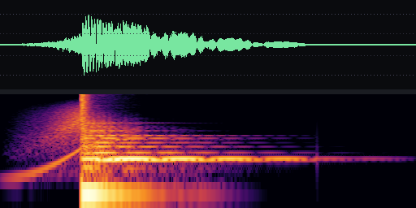
- `amb_shikijo` — 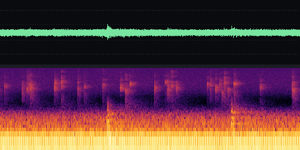
- `door_close` — 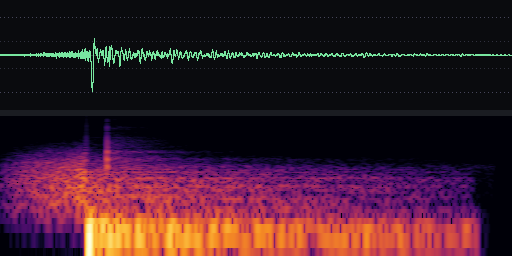
- `cat_scratch_1` — 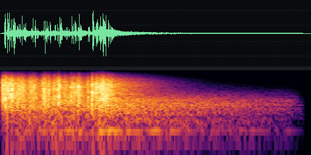
- `coffin_knock` — 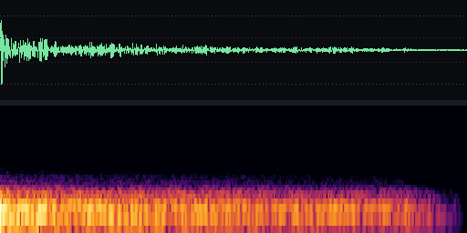
- `phone_ring` — 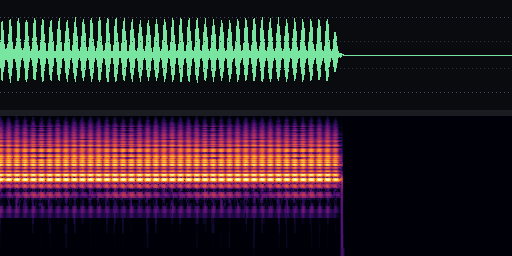
- `door_open` — 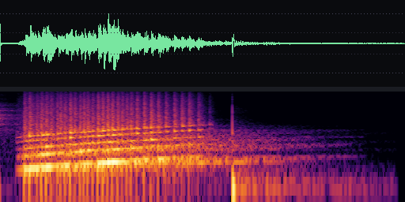
- `cat_meow_1` — 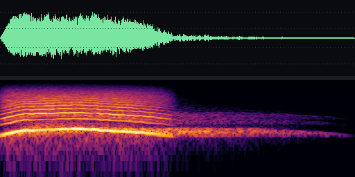
- `stinger_1` — 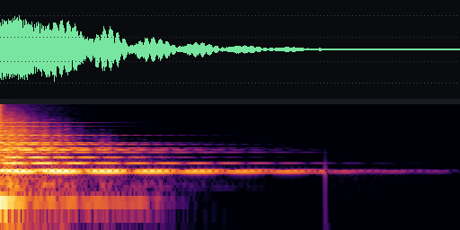
- `amb_room` — 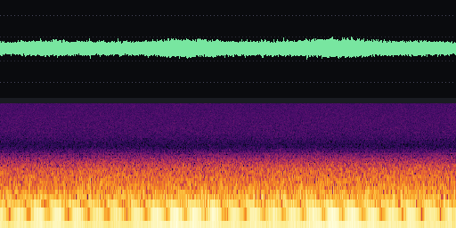
- `amb_outside` — 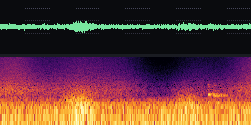
- `amb_tatami` — 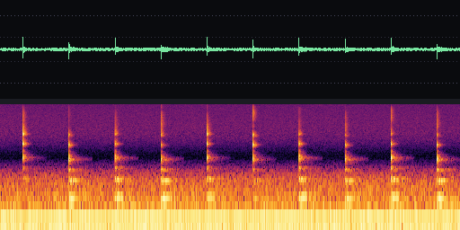
- `step_lino_1` — 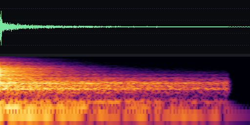
- `kasha_screech` — 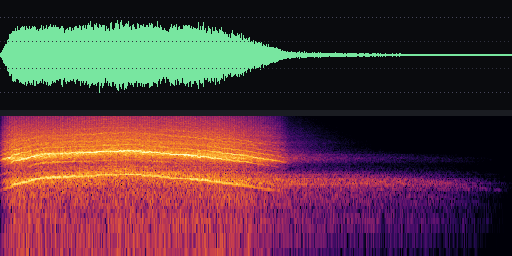
- `chime_dawn` — 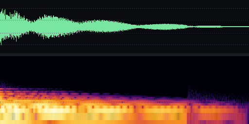
- `heartbeat` — 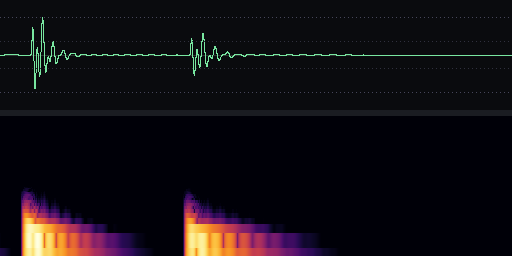
- `incense_light` — 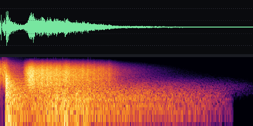
- `whisper_1` — 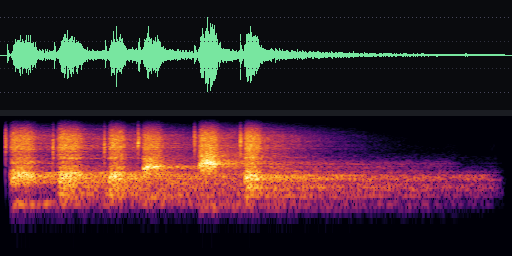
- `water_pour` — 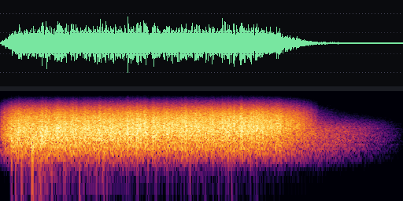
- `amb_drone_low` — 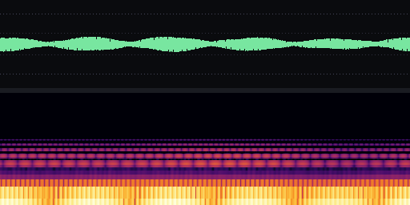
